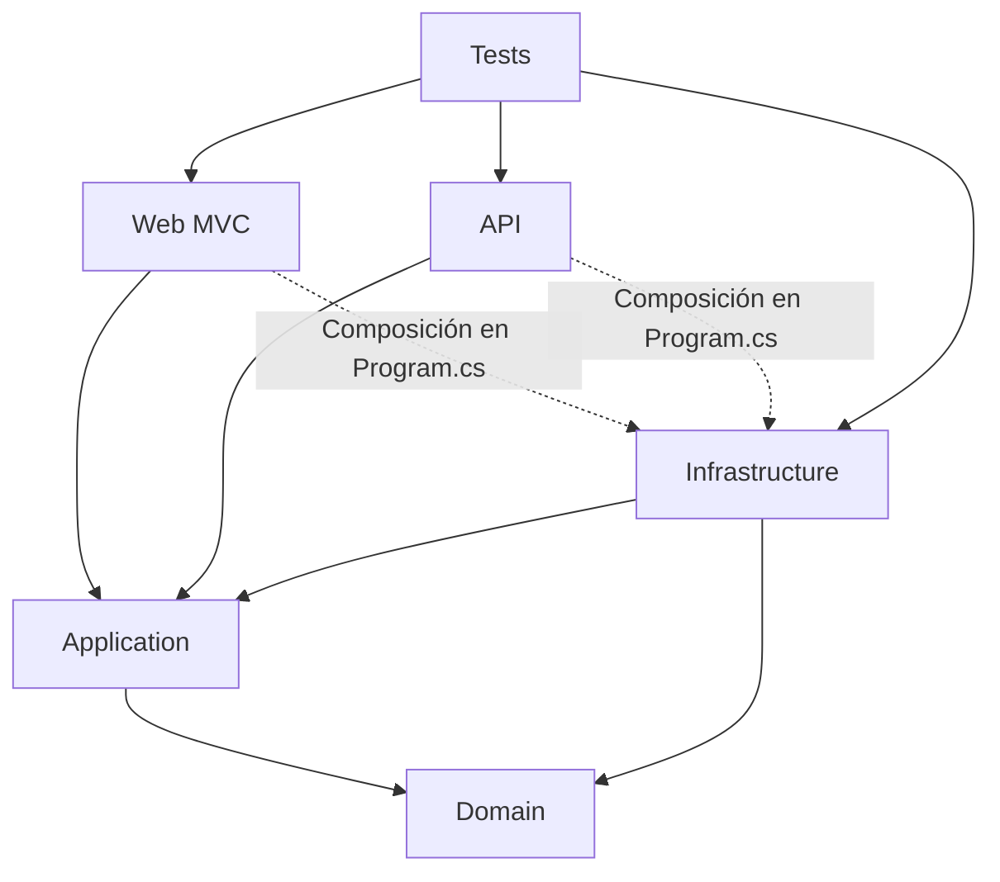

# Dependencias de PortalMercado

Domain no referencia ASP.NET ni EF Core. Application solo referencia Domain.
Infrastructure implementa los contratos de Application. Los hosts registran servicios
mediante AddInfrastructure en Program.cs. Controllers usan interfaces de Application;
no contienen consultas SQL. EF se limita a cinco tablas; no se genera el esquema.
IStoredProcedureExecutor expone únicamente pm_ConsultarSaldos, con parámetros tipados.
Negocio.IdComerciante se conserva como FK escalar; Comerciante está fuera del modelo
piloto y SQL Server conserva su restricción. No se navega esa relación desde EF.

Hay middleware equivalente en los dos hosts, en espacios de nombres distintos, para
no introducir una dependencia Web -> API ni frameworks web en Domain/Infrastructure.
Las dos implementaciones deben mantenerse alineadas mientras no exista un módulo web
compartido autorizado en una etapa posterior.
