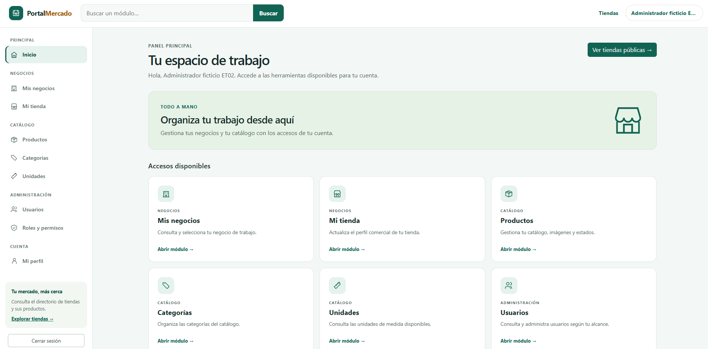
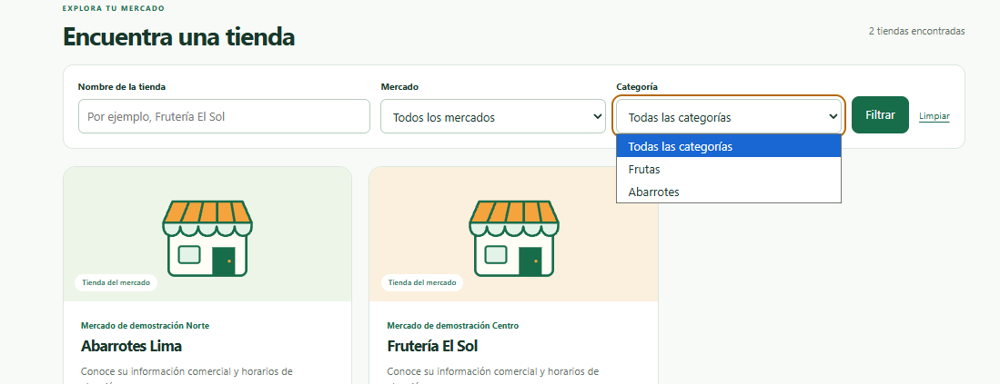
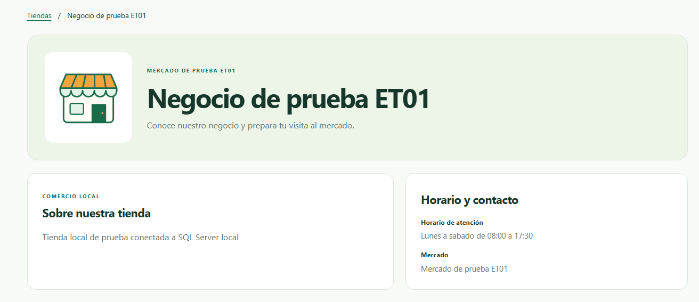
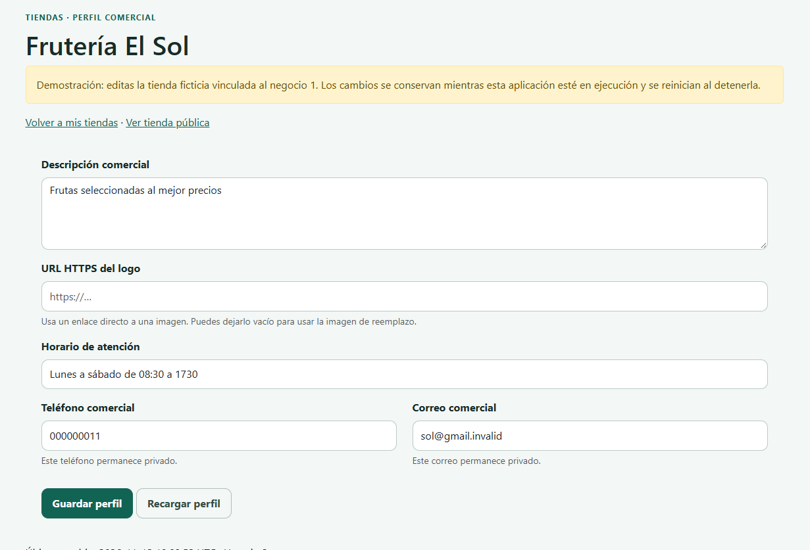
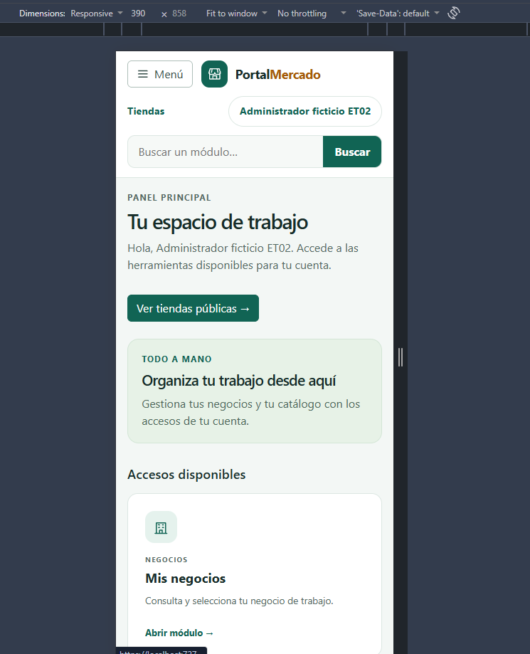

# Manual breve · Tiendas virtuales

PortalMercado · Programador B · Ciclo 2 · Revisión del 13 de noviembre de 2026.
La ejecución confirmada utiliza SQL Server local. Las capturas indicadas como
«demostración» ilustran la misma interfaz con datos ficticios en memoria; no
acreditan datos de la base SQL. La ficha identificada como SQL corresponde a
la copia PortalMercado_ET01_Test.

## Entrar al sistema

Con la Web iniciada, visitar https://localhost:7275/tiendas para consultar el
portal sin iniciar sesión. Para administrar un perfil, ingresar con la cuenta
existente autorizada. No se necesita una cuenta para consultar tiendas públicas.

El inicio privado presenta accesos de acuerdo con los permisos de la cuenta.
«Tiendas» abre el portal público y «Mi tienda» permite elegir el negocio.

## Buscar una tienda

En el directorio, escribir el nombre, seleccionar mercado o categoría y pulsar
Filtrar. Limpiar elimina los filtros. Abrir una tarjeta para consultar su ficha.
Una tienda oculta, inactiva o un slug inexistente no publica su información.

La siguiente captura ilustra los filtros con los datos del modo demostración:

## Consultar ficha y productos

En SQL local, la tienda habilitada es Negocio de prueba ET01:
https://localhost:7275/tiendas/negocio-prueba-et01.
Se muestran descripción, horario, mercado, puestos vigentes cuando existan y
productos publicados del negocio. Los contactos privados y datos fiscales
permanecen ocultos. Si no hay logo, se utiliza una ilustración de reemplazo.

En Productos de la tienda, buscar por nombre, filtrar categoría u ordenar por
nombre/menor precio/mayor precio. Anterior y Siguiente conservan esos filtros.
Si una búsqueda no tiene resultados aparece un estado vacío.
Agregar al carrito está deshabilitado: el ciclo no crea pedidos ni cobros.

Para una demostración local con dos páginas, ejecutar opcionalmente el script
`database/ciclo2-local/04_Datos_Catalogo_Publico_Prueba.sql` en la base de pruebas.
Agrega quince productos propios del negocio ficticio y dos categorías. No
modifica productos existentes; al reejecutarlo no restablece valores editados.
La lectura pública sigue excluyendo productos BORRADOR/SUSPENDIDO/AGOTADO.

## Editar el perfil comercial

1. Iniciar sesión y abrir Mi tienda.
2. Seleccionar el Negocio de prueba ET01.
3. Editar descripción, URL HTTPS del logo, horario y contactos comerciales.
4. Guardar y abrir Ver tienda pública.

Los nombres, slug, estado, mercado y datos fiscales no se editan en este formulario.
Cambiar un teléfono o correo no autoriza automáticamente su publicación.
Una cuenta de otro negocio recibe acceso denegado al intentar editarlo.

Esta captura ilustra los campos del formulario en modo demostración:

En SQL local, el formulario muestra que los cambios se guardan en SQL Server.
Tras guardar, se conservan al reiniciar la Web. Si dos pestañas intentan guardar
la misma versión, la segunda recibe un conflicto: pulsar Recargar perfil,
revisar los cambios actuales y volver a editar.

El logo admite una URL HTTPS sin credenciales; vacío o fallo de carga utiliza
el reemplazo. La verificación del MIME y tamaño del archivo remoto todavía no
está implementada y no se presenta como control completado de RF-B2-08.

## Navegación móvil

El botón Menú abre los accesos en pantallas pequeñas. Volver a pulsarlo cierra
el menú; Escape también lo cierra y devuelve el foco al botón. Las tarjetas del
panel pasan a una columna. Se verificó visualmente el panel a 390 px.

La revisión manual de directorio, catálogo, filtros y formulario público/privado
en móvil debe completarse y conservarse como evidencia de CA-04 y CA-05.

## Ejecución y pruebas

La instalación, configuración y comandos se encuentran en
[GUIA_TIENDAS_SQL_LOCAL_CICLO2.md](GUIA_TIENDAS_SQL_LOCAL_CICLO2.md).
La suite completa comunicada por el desarrollador terminó con 350 correctas,
cero errores y cero omitidas tras la corrección de EF/trigger.
El TRX debe copiarse a docs/evidencias/ciclo2. Este manual no incluye un TRX
recreado: el original se genera en el equipo Windows del desarrollador.

El SQL local fue autorizado expresamente al trabajar individualmente. La
integración central y revisión conjunta con A/DBA no se han realizado.
